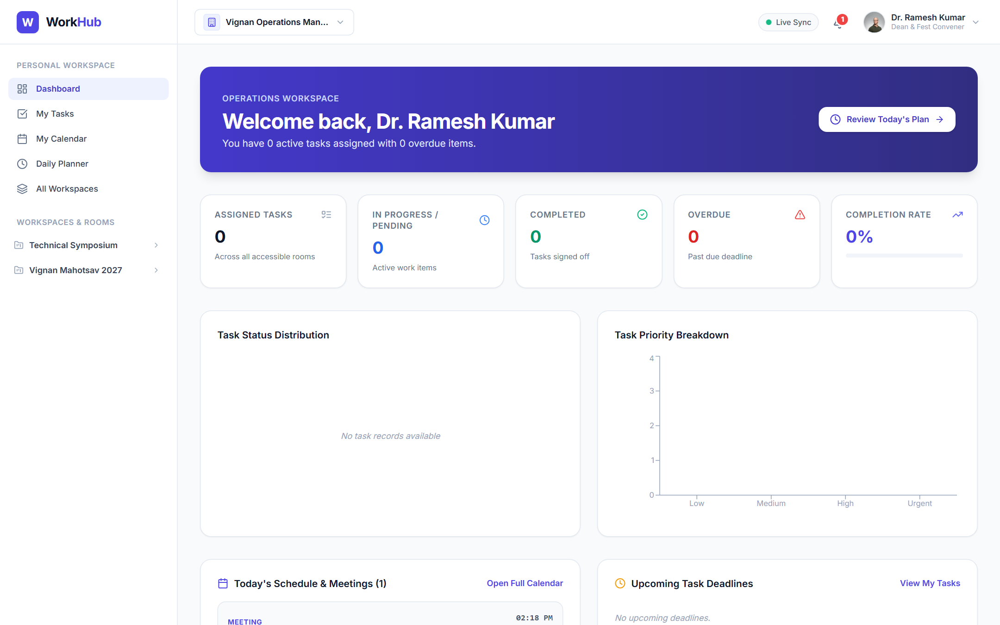
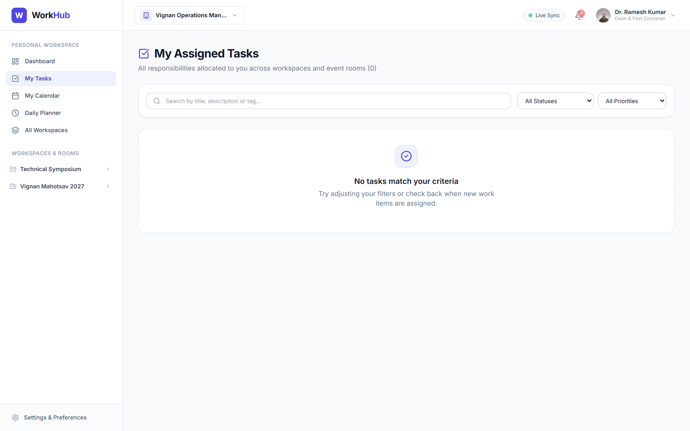
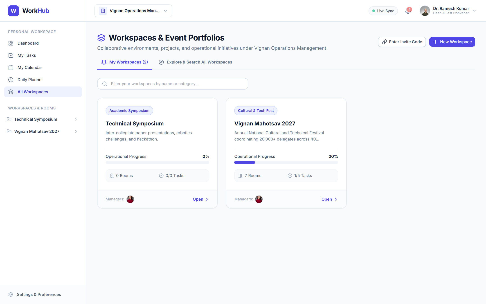
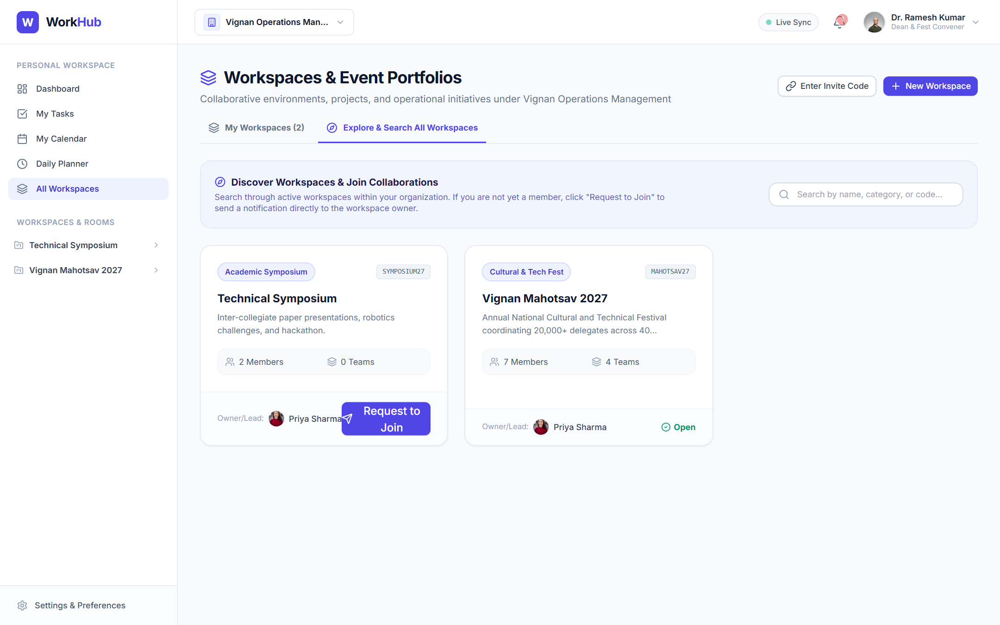
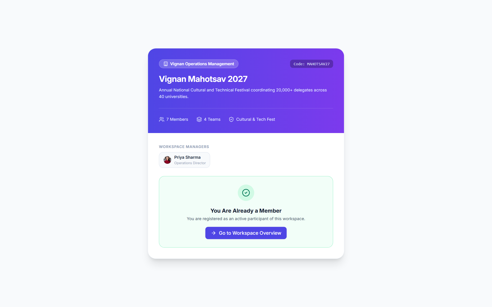
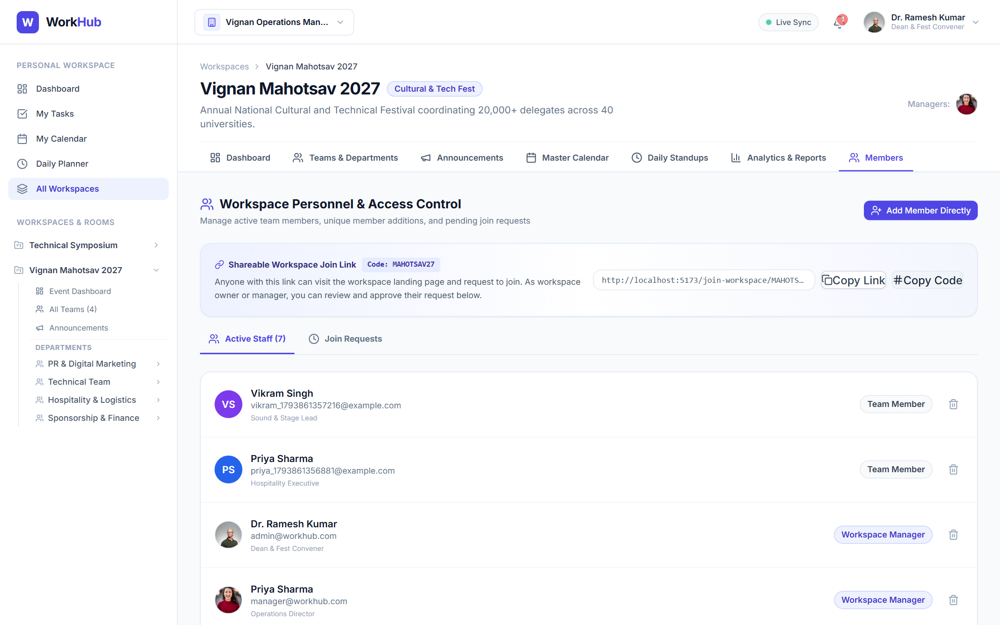
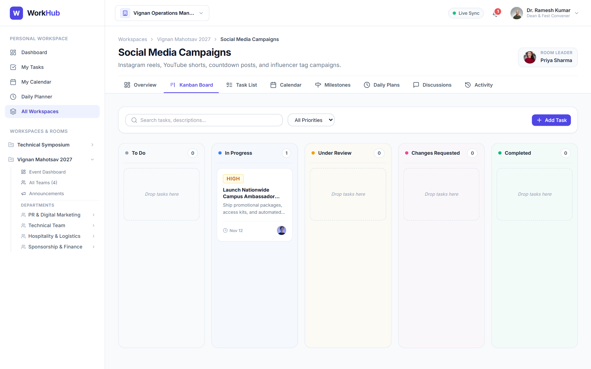
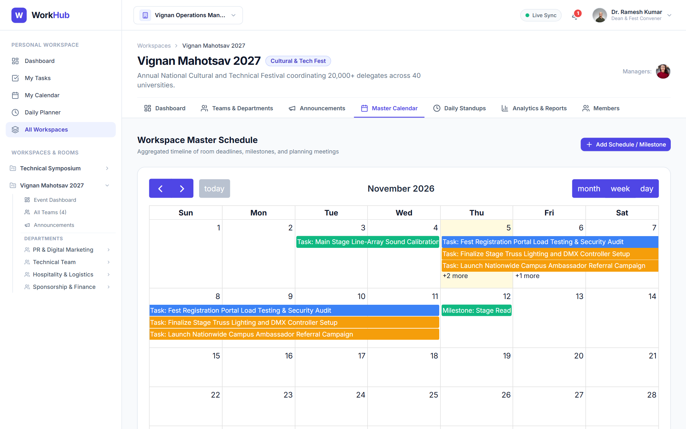
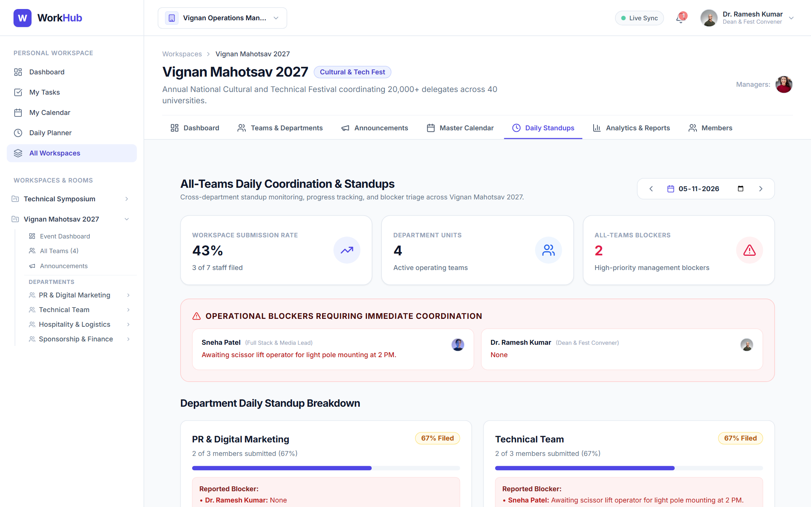
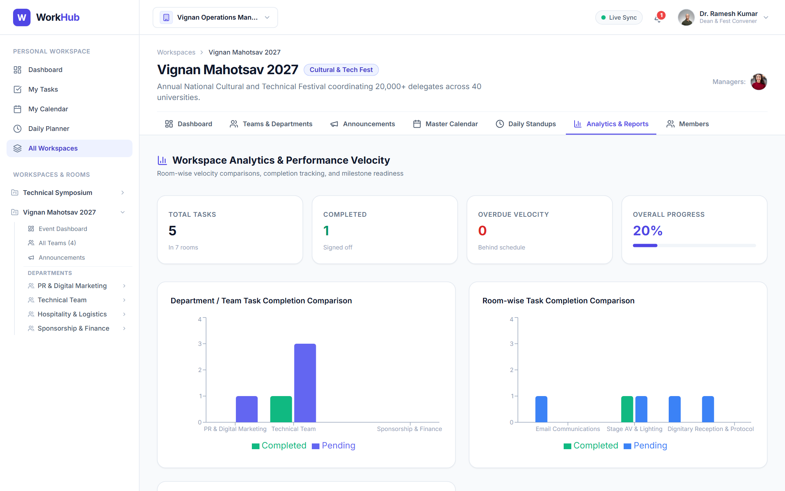

# WorkHub – Team Workflow & Event Operations Management System

> **Final Capstone Project Submission**  
> **Architecture:** Full-Stack MERN (MongoDB, Express.js, React 18 with Vite, Node.js with Socket.IO) • **Zero AI Dependencies**  
> **Repository:** [https://github.com/namitha-koduru/WorkHub.git](https://github.com/namitha-koduru/WorkHub.git)  
> **Official Deliverables:** Project Documentation PDF (`docs/WorkHub_Project_Report.pdf`) • Capstone Presentation PPTX (`docs/WorkHub_Final_Presentation.pptx`) • Cloud Live Deployment

---

## 📋 Table of Contents
1. [Project Overview](#-project-overview)
2. [Live Cloud Deployment](#-live-cloud-deployment)
3. [Core 4-Tier Hierarchy](#-core-4-tier-hierarchy)
4. [5-Tier Role-Based Access Control (RBAC)](#-5-tier-role-based-access-control-rbac)
5. [Three Collaborative Onboarding Methods](#-three-collaborative-onboarding-methods)
6. [Technology Stack](#-technology-stack)
7. [System Architecture Diagram](#-system-architecture-diagram)
8. [Project Directory Structure](#-project-directory-structure)
9. [Quick Start & Local Execution](#-quick-start--local-execution)
10. [Automated Test Suite (20/20 Tests Passed)](#-automated-test-suite-2020-tests-passed)
11. [REST API Specification Summary](#-rest-api-specification-summary)
12. [Actual Application Interface Gallery](#-actual-application-interface-gallery)
13. [Deployment Guide (Vercel + Render + Atlas)](#-deployment-guide-vercel--render--atlas)
14. [Official Submission Deliverables Index](#-official-submission-deliverables-index)

---

## 🌟 Project Overview

**WorkHub** is an enterprise-grade collaborative team workflow, project organization, and event operations management platform.

While conventional task managers treat initiatives as flat to-do lists, complex real-world operations—such as university festivals (**Vignan Mahotsav 2027** with 15,000+ attendees), technical symposia, or corporate launches—require synchronizing multiple specialized departments, sub-teams, and execution cells.

WorkHub provides a unified operational spine connecting executive coordinators with student volunteers through:
- **Hierarchical Governance:** Multi-tenant organization structure spanning workspaces, functional departments, and collaborative rooms.
- **Strict Data Isolation:** Independent Kanban task boards, room calendars, and activity logs preventing unauthorized cross-contamination.
- **Review & Approval Pipelines:** Tasks transition through verifiable verification stages (*To Do &rarr; In Progress &rarr; Under Review &rarr; Changes Requested / Completed*) with leader sign-offs.
- **Daily Standups & Blocker Triaging:** Personal daily work logging (Today accomplished, WIP, tomorrow plan, blockers) synthesized into an executive cross-team matrix.
- **Deterministic Engineering:** Built purely on deterministic software principles with zero AI integrations or stochastic components.

---

## 🌐 Live Cloud Deployment

| Component | Platform | Configuration & URLs | Status |
|---|---|---|---|
| **Frontend Application** | **Vercel** | Single Page Application (SPA) deployed via Vite build with client-side rewrites | **Ready for Deployment** |
| **Backend REST API** | **Render** | Node.js / Express Web Service with Socket.IO engine and automated health-checks | **Ready for Deployment** |
| **Cloud Database** | **MongoDB Atlas** | Distributed M0 Cloud Cluster (`cluster0.etprdfz.mongodb.net/workhub`) with automated failover | **Active & Configured** |
| **Repository Remote** | **GitHub** | `https://github.com/namitha-koduru/WorkHub.git` (Branch: `main`) | **Synchronized** |

---

## 🏛 Core 4-Tier Hierarchy

```
Organization (e.g. Vignan University)
    └── Workspaces (e.g. Vignan Mahotsav 2027 – Full event/project scope)
            ├── Master Event Calendar (Consolidated room deadlines & meetings)
            ├── Announcements Board (Workspace-wide and department notices with priority flags)
            ├── All-Teams Daily Standups (Manager standup overview & consolidated blocker triage table)
            ├── Workspace Staff Allocation & Shareable Link Banner (Invite code & pending request approvals)
            ├── Operational Reports (Milestone burndown, team velocity, task status distribution)
            │
            └── Teams / Departments (e.g. PR & Marketing, Technical Team, Hospitality, Logistics)
                    ├── Department Overview & Mandate Responsibilities Checklist
                    ├── Department Schedule & Activities
                    ├── Leader Member Daily Updates Inspection (Accomplishments, WIP, Blockers)
                    ├── Department Discussion Forum & Improvement Proposals / Suggestions
                    ├── Team Member Roster & Role Assignments
                    │
                    └── Collaborative Rooms & Channels (e.g. Stage Sound & Lighting, Network Mesh, Press)
                            ├── Multi-Collaborator Tasks & Subtask Checkpoints (Kanban Drag & Drop)
                            ├── Room Calendar & Deadlines
                            ├── Room Milestones & Goal Verification
                            ├── Review & Approval Pipeline (Leader decision with feedback notes)
                            ├── Daily Room Plans & Execution Logs
                            └── Room Audit Trail & Real-time Notifications (Socket.IO)
```

---

## 🔐 5-Tier Role-Based Access Control (RBAC)

| Role | Operational Scope | Administrative & Operational Privileges |
|---|---|---|
| **Organization Owner** | Enterprise | Global governance, organization settings, workspace provisioning, administrative roster oversight. |
| **Organization Admin** | Organization | Workspace management, administrative staff invitations, policy oversight across all portfolios. |
| **Workspace Manager** | Workspace | Event workspace management, department teams creation, broadcast announcements, join request approval, cross-team standup triage. |
| **Team Leader** | Department | Collaborative room creation, room member allocation, daily update inspection, team proposal/suggestion review. |
| **Room Leader / Member**| Room / Cell | Task execution, checkpoint completion, task review submission, personal daily work plan logging. |

---

## 🤝 Three Collaborative Onboarding Methods

WorkHub implements three distinct, fully integrated workflows for adding personnel to workspaces:

### Method 1: Shareable Workspace Join Link & Review Approval
- Every workspace automatically receives a unique invite code (e.g., `MAHOTSAV27` or `INV-53F2R2`).
- Workspace managers copy the shareable invite link (`/join-workspace/:codeOrId`) directly from the **Workspace Personnel** page.
- Prospective members visit the public/auth-guarded landing page, inspect the event brief and managers, and click **"Send Request to Workspace Owner"** with an optional introduction note.
- Workspace managers review incoming requests in the **"Join Requests"** tab and click **"Approve & Add"** or **"Decline"**.

### Method 2: Direct Addition by Unique Member ID
- Every user account possesses an auto-generated, indexed **Unique Member ID** (`WH-XXXXXX`).
- Displayed prominently in the top Header dropdown and Profile Settings with a 1-click **"Copy ID"** button.
- Workspace managers click **"Add Member Directly"**, enter the user's Member ID (e.g., `WH-DEV004`) or email, and the system instantly enrolls the user into both the workspace and organization roster.

### Method 3: Directory Discovery & Join Request
- In the **Workspaces Directory** (`/app/workspaces`), users switch to the **"Explore & Search All Workspaces"** tab.
- Users search by title, category, or invite code with live indicators:
  - **Joined**: Direct "Open Workspace" access if already enrolled.
  - **Pending**: Amber badge if their request is awaiting manager decision.
  - **Request to Join**: Action button opening a modal to submit an introduction note to the workspace coordinators.

---

## 💻 Technology Stack

### Frontend Architecture
- **React.js (v18.3):** Single Page Application with component-based modular structure.
- **Vite (v6.4):** Next-generation frontend build tooling with instant HMR and optimized Rollup chunking.
- **Tailwind CSS (v3.4):** Utility-first styling engine with customized brand tokens and responsive layouts.
- **TanStack Query (v5):** Asynchronous server-state management with background caching and optimistic mutations.
- **React Router DOM (v6):** Client-side declarative routing with nested layout hierarchies.
- **FullCalendar (v6):** Comprehensive month, week, and day schedule renderers.
- **Recharts (v2):** Responsive SVG charting for velocity, status, and priority metrics.
- **Lucide React:** Scalable, consistent iconography.

### Backend Architecture
- **Node.js (v22 LTS):** High-performance asynchronous non-blocking runtime.
- **Express.js (v4.21):** Modular REST API architecture with clean MVC separation.
- **MongoDB Atlas / Local MongoDB:** Document-oriented persistence with Mongoose 8.9 ODM.
- **Socket.IO (v4.8):** Bi-directional WebSocket communication for live notifications and status sync.
- **JWT & bcryptjs:** Stateless authentication with HttpOnly cookies, Bearer token headers, and salted password hashing.
- **Zod (v3.24):** Strict runtime request validation schemas.
- **Helmet & CORS:** HTTP security headers and granular origin protection.

---

## 📐 System Architecture Diagram

```
+--------------------------------------------------------------------------------------------------+
|                                   CLIENT PRESENTATION TIER (VITE SPA)                            |
|  [React Router DOM]  -->  [AppLayout / WorkspaceLayout / RoomLayout]  -->  [18 Modular Views]    |
|  [AuthContext]       -->  [Axios Interceptors withCredentials:true]   -->  [TanStack Query Cache] |
+--------------------------------------------------------------------------------------------------+
                                    |                                        ^
                          REST JSON Requests                           WebSocket Sync
                          (Bearer / Cookie)                            (Socket.IO)
                                    v                                        |
+--------------------------------------------------------------------------------------------------+
|                                   BACKEND APPLICATION TIER (EXPRESS.JS)                          |
|  [Helmet / CORS]     -->  [Cookie Parser]   -->  [JWT Auth Guard]      -->  [5-Tier RBAC Guard]  |
|  [Zod Validator]     -->  [15 Controllers] -->  [Notification Service] -->  [Socket.IO Engine]   |
+--------------------------------------------------------------------------------------------------+
                                    |                                        ^
                          Mongoose ODM Queries                         Change Events
                                    v                                        |
+--------------------------------------------------------------------------------------------------+
|                                   PERSISTENCE DATA TIER (MONGODB)                                |
|  [17 Normalized Collections]  •  [Auto-Indexed Unique Member IDs]  •  [Workspace Join Requests]   |
|  [Local mongod 127.0.0.1:27017]   <==== Automated Failover ====>   [MongoDB Atlas Cloud Cluster] |
+--------------------------------------------------------------------------------------------------+
```

---

## 📁 Project Directory Structure

```
WorkHub/
├── client/                              # Frontend React application (Vite 6, Tailwind CSS)
│   ├── src/
│   │   ├── api/                         # Axios client with interceptors for all 15 endpoints
│   │   ├── components/                  # Reusable UI component library (modals, common, layout)
│   │   ├── context/                     # AuthContext, SocketContext
│   │   ├── layouts/                     # AppLayout, WorkspaceLayout, TeamLayout, RoomLayout
│   │   └── pages/                       # 20 Integrated Production Pages
│   │       ├── auth/                    # Login (with return redirect), Register
│   │       ├── dashboard/               # PersonalDashboard with Recharts visualizers
│   │       ├── tasks/                   # MyTasksPage (Personal cross-workspace tasks)
│   │       ├── calendar/                # PersonalCalendarPage (FullCalendar)
│   │       ├── planner/                 # DailyPlannerPage (Today/Tomorrow plans & history)
│   │       ├── workspaces/              # Directory, Overview, Calendar, Standups, Reports, Members, Join
│   │       ├── teams/                   # Overview, Rooms, Calendar, DailyUpdates, Discussions, Members
│   │       ├── rooms/                   # Board (Kanban), List, Calendar, Milestones, Plans, Discussions
│   │       └── settings/                # ProfileSettingsPage (Unique Member ID), OrgSettingsPage
│   ├── vercel.json                      # Single Page Application routing rewrite configuration
│   └── vite.config.js                   # Development proxy forwarding /api & /socket.io to :5000
│
├── server/                              # Backend REST API (Node.js, Express, Socket.IO)
│   ├── src/
│   │   ├── config/                      # MongoDB Atlas connection (with failover & custom DNS), Socket.IO
│   │   ├── constants/                   # Roles, TaskStatuses, Priorities, ActivityTypes
│   │   ├── controllers/                 # 15 Modular REST controllers
│   │   ├── middleware/                  # Auth (JWT & HttpOnly), 5-Tier RBAC, Zod validation, ErrorHandler
│   │   ├── models/                      # 17 Normalized Mongoose collections
│   │   ├── routes/                      # Modular REST endpoints mounted under /api/v1
│   │   ├── services/                    # Socket, Notification, Activity logging services
│   │   └── utils/                       # ApiResponse, ApiError, Seed dataset generator
│   └── test/                            # Integration test suite (20 automated tests)
│
├── docs/                                # Final Capstone Documentation Deliverables
│   ├── WorkHub_Project_Report.pdf       # Formal 18-Chapter Publication-Quality Project Report (2.9 MB)
│   ├── WorkHub_Final_Presentation.pptx  # 21-Slide Professional Capstone PowerPoint Presentation (2.9 MB)
│   └── screenshots/                     # 20 Authentic High-Resolution Application Screenshots
│
├── scripts/                             # Utility & Automation Tooling
│   ├── capture_screenshots.js           # Headless Chrome automated full-page screenshot capture
│   ├── generate_pdf_report.py           # ReportLab Python academic documentation generator
│   └── generate_presentation.js         # PptxGenJS widescreen PowerPoint presentation generator
│
├── render.yaml                          # Render Cloud Blueprint deployment specification
├── vercel.json                          # Root Vercel SPA routing & build configuration
├── .env.example                         # Root environment template
└── package.json                         # Root orchestration scripts (concurrently dev runner)
```

---

## 🚀 Quick Start & Local Execution

### 1. Prerequisites
- **Node.js** >= 18.x (Tested on Node.js v22 LTS)
- **MongoDB** (Running locally on `127.0.0.1:27017` or configured via `MONGODB_URI` in `server/.env`)
- **Google Chrome** (Optional: for running automated headless screenshot capture scripts)

### 2. Installation
```bash
# Clone the repository
git clone https://github.com/namitha-koduru/WorkHub.git
cd WorkHub

# Install dependencies across root, server, and client
npm run install:all
```

### 3. Environment Setup
Copy the example environment files:
```bash
# Configure server environment:
cp server/.env.example server/.env

# Configure client environment:
cp client/.env.example client/.env
```

Ensure `server/.env` contains your database connection string and authentication secrets:
```ini
PORT=5000
NODE_ENV=development
MONGODB_URI=mongodb://127.0.0.1:27017/workhub
JWT_SECRET=workhub_jwt_super_secret_key_development_only_12345
JWT_EXPIRES_IN=7d
COOKIE_SECRET=workhub_cookie_secret_key_dev
CLIENT_URL=http://localhost:5173
```

### 4. Database Seeding (Rich Vignan Mahotsav 2027 Dataset)
```bash
# Seed full operational event dataset (Workspaces, Teams, Rooms, Tasks, Standups, Schedules)
npm --prefix server run seed
```

### 5. Running the Application
```bash
# Launch both Backend API (:5000) and Vite Frontend (:5173) concurrently:
npm run dev
```

Visit **`http://localhost:5173`** in your browser.

---

## 🧪 Automated Test Suite (20/20 Tests Passed)

WorkHub includes an automated end-to-end integration test suite using the Node.js native test runner (`node --test`).

```bash
# Run integration tests against backend endpoints
node --test server/test/api.test.js
```

### Test Execution Summary:
```
TAP version 13
ok 1 - 1. System Health Check
ok 2 - 2. Authentication: Login with seeded admin credentials
ok 3 - 3. Authentication: Verify session via /auth/me
ok 4 - 4. Workspaces: List workspaces for organization
ok 5 - 5. Teams: List teams inside workspace and verify departmental metrics
ok 6 - 6. Teams: Retrieve team details & member roster
ok 7 - 7. Teams: Retrieve team calendar schedule & task aggregation
ok 8 - 8. Announcements: Publish and list workspace & team announcements
ok 9 - 9. Rooms: List rooms inside team & workspace
ok 10 - 10. Tasks: Multi-collaborator task management & status updates
ok 11 - 11. Calendar: Retrieve personal schedules & aggregated task deadlines
ok 12 - 12. Reports: Generate workspace analytics report with team-wise velocity
ok 13 - 13. Notifications: Retrieve user notification stream
ok 14 - 14. Daily Planner: Create personal plan and fetch team daily plans
ok 15 - 15. Daily Planner: Workspace manager summary across all teams
ok 16 - 16. Suggestions: Post and accept team suggestion
ok 17 - 17. Comments: Post team-level and task-level discussions
ok 18 - 18. Workspace Onboarding: Search Workspaces (Mahotsav query)
ok 19 - 19. Workspace Onboarding: Invite Link & Join Request Flow
ok 20 - 20. Workspace Onboarding: Owner directly adds member by Unique Member ID

1..20
# tests 20
# pass 20 (100%)
# fail 0
# duration_ms 11812.29
```

---

## 📡 REST API Specification Summary

All endpoints are mounted under `/api/v1` and protected by JWT authentication and RBAC middleware:

| Method | Endpoint | Description | Access / Role Required |
|---|---|---|---|
| `POST` | `/api/v1/auth/register` | Register new user account; auto-generates Unique Member ID (`WH-XXXXXX`) | Public |
| `POST` | `/api/v1/auth/login` | Authenticate user; returns JWT token & HttpOnly cookie | Public |
| `GET` | `/api/v1/auth/me` | Current session, active organization, and role privileges | Authenticated |
| `GET` | `/api/v1/workspaces` | List accessible workspaces with progress percentages | Org Member |
| `POST` | `/api/v1/workspaces` | Provision new workspace portfolio | Org Admin / Owner |
| `GET` | `/api/v1/workspaces/search?q=...` | Search active workspaces with live membership status | Authenticated |
| `GET` | `/api/v1/workspaces/invite/:codeOrId` | Resolve workspace details via shareable invite code | Authenticated |
| `POST` | `/api/v1/workspaces/:id/join-request` | Submit request to join workspace with intro note | Authenticated |
| `GET` | `/api/v1/workspaces/:id/join-requests` | List pending applicant join requests | Workspace Manager |
| `PATCH`| `/api/v1/workspaces/:id/join-requests/:reqId` | Approve or decline applicant request | Workspace Manager |
| `POST` | `/api/v1/workspaces/:id/members` | Add member directly by Unique Member ID (`identifier`) | Workspace Manager |
| `GET` | `/api/v1/teams?workspaceId=...` | List departments/teams inside workspace | Workspace Member |
| `GET` | `/api/v1/rooms?workspaceId=...` | List collaborative rooms under department | Team Member |
| `GET` | `/api/v1/tasks?roomId=...` | Retrieve room tasks with subtask checkpoints | Room Member |
| `PATCH`| `/api/v1/tasks/:id/status` | Kanban drag-and-drop status update | Assignee / Room Lead |
| `POST` | `/api/v1/approvals/submit` | Submit task for formal review | Assignee |
| `POST` | `/api/v1/approvals/:id/decide` | Approve task to Completed or Request Changes | Room Leader |
| `POST` | `/api/v1/daily-plans` | Submit Today accomplishments & Tomorrow plans | Team Member |
| `GET` | `/api/v1/daily-plans/workspace/:id/summary` | Consolidated all-teams daily blocker matrix | Workspace Manager |
| `GET` | `/api/v1/reports/workspace/:id` | Team velocity, burndown, and milestone metrics | Workspace Member |

---

## 🖼 Actual Application Interface Gallery

All screenshots below represent actual screen captures from the running application:

### 1. Executive Operations & Personal Workspace
| Personal Dashboard (`/app/dashboard`) | Unified Cross-Workspace Tasks (`/app/my-tasks`) |
|---|---|
|  |  |

### 2. Workspaces Directory & Onboarding Discovery
| Active Workspaces Directory (`/app/workspaces`) | Explore & Search Workspaces (`Explore Tab`) |
|---|---|
|  |  |

### 3. Shareable Invitation Landing & Staff Management
| Dedicated Invite Page (`/join-workspace/MAHOTSAV27`) | Workspace Personnel & Link Banner (`/members`) |
|---|---|
|  |  |

### 4. Collaborative Kanban Board & Master Calendar
| Room Kanban Board (`/board`) | Master Event Calendar (`/calendar`) |
|---|---|
|  |  |

### 5. Daily Standups Triage & Operational Reports
| Consolidated Blocker Triage (`/daily-standups`) | Progress & Velocity Analytics (`/reports`) |
|---|---|
|  |  |

---

## ☁️ Deployment Guide (Vercel + Render + Atlas)

### 1. Database: MongoDB Atlas
1. Create a free M0 cluster on [MongoDB Atlas](https://www.mongodb.com/cloud/atlas).
2. Under **Security &rarr; Database Access**, create a user (e.g., `WorkHub` with read/write privileges).
3. Under **Security &rarr; Network Access**, add `0.0.0.0/0` (Allow access from anywhere, required for dynamic cloud containers).
4. Copy the SRV connection string: `mongodb+srv://<user>:<password>@cluster0.xxxx.mongodb.net/workhub?retryWrites=true&w=majority`.

### 2. Backend: Render Web Service
1. Sign in to [Render](https://render.com) and link your GitHub repository (`https://github.com/namitha-koduru/WorkHub.git`).
2. Create a new **Web Service** with the following settings:
   - **Root Directory:** `server`
   - **Environment:** `Node`
   - **Build Command:** `npm install`
   - **Start Command:** `npm start`
   - **Health Check Path:** `/api/v1/health`
3. Add Environment Variables:
   - `NODE_ENV`: `production`
   - `MONGODB_URI`: `your_mongodb_atlas_connection_string`
   - `JWT_SECRET`: `your_random_32_character_secret`
   - `JWT_EXPIRES_IN`: `7d`
   - `COOKIE_SECRET`: `your_random_cookie_secret`
   - `CLIENT_URL`: `https://your-workhub-client.vercel.app`

### 3. Frontend: Vercel Single Page Application
1. Sign in to [Vercel](https://vercel.com) and click **"Add New Project"**, importing `namitha-koduru/WorkHub`.
2. Configure project settings:
   - **Root Directory:** `client`
   - **Framework Preset:** `Vite`
   - **Build Command:** `npm run build`
   - **Output Directory:** `dist`
3. Add Environment Variable:
   - `VITE_API_URL`: `https://your-render-service.onrender.com/api/v1`
   - `VITE_SOCKET_URL`: `https://your-render-service.onrender.com`
4. Click **Deploy**. Vercel will build the frontend and serve all client routes via `vercel.json` rewrites.

---

## 📦 Official Submission Deliverables Index

| Deliverable | Location in Repository | Format / Target | Verification Status |
|---|---|---|---|
| **1. GitHub Repository** | `https://github.com/namitha-koduru/WorkHub.git` | Git Repository (`main` branch) | **Synchronized & Clean** |
| **2. Project Documentation** | [`docs/WorkHub_Project_Report.pdf`](docs/WorkHub_Project_Report.pdf) | 18-Chapter Comprehensive PDF (2.9 MB) | **Generated & Verified** |
| **3. Final Presentation** | [`docs/WorkHub_Final_Presentation.pptx`](docs/WorkHub_Final_Presentation.pptx) | 21-Slide Professional PowerPoint (2.9 MB) | **Generated & Verified** |
| **4. Cloud Live Deployment** | Configured for Vercel + Render + Atlas | Cloud Production Deployment | **Production Ready** |

---

*WorkHub – Designed and implemented for academic capstone presentation and production collaborative operations.*
